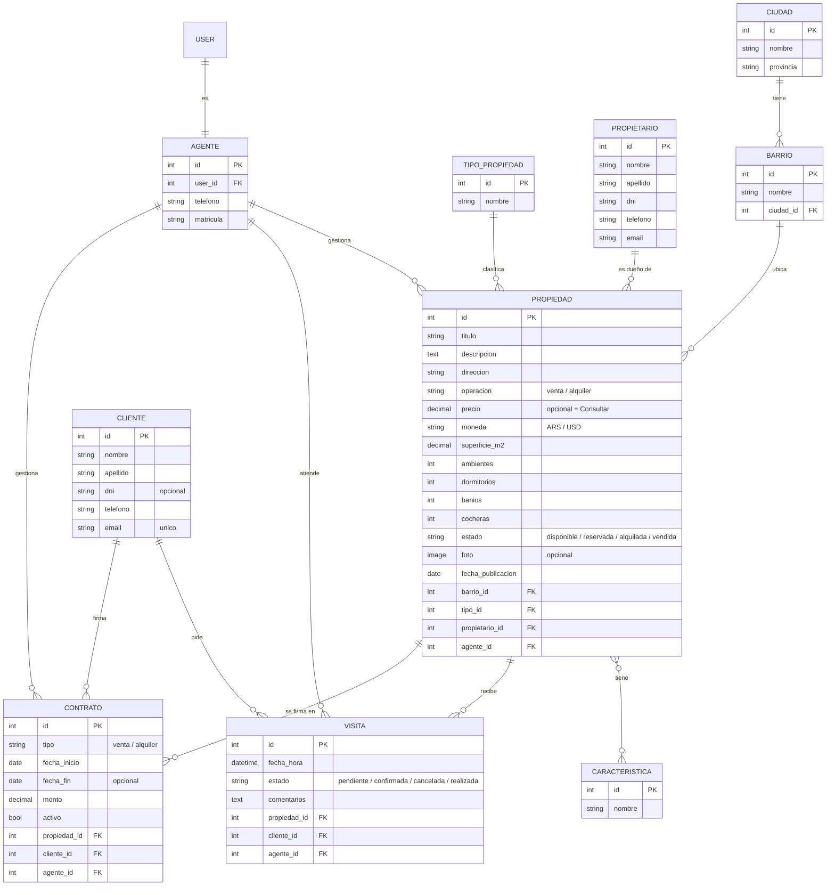

# 🏠 Inmobiliaria Riri — API REST

Back de la Evaluación Final Integradora de **Ingeniería de Software** (ITEC - Desarrollo de Software, 2026).

**Inmobiliaria Riri** es una inmobiliaria de Río Cuarto que se dedica a la venta y alquiler de casas, departamentos, locales y lotes. Esta API REST, hecha con **Django REST Framework**, expone las propiedades con sus filtros de búsqueda, los agentes de contacto y la gestión interna de clientes, visitas y contratos. Después la consume el front que hacemos en Programación III.

## 🛠️ Tecnologías

- Python 3.12
- Django 6.1
- Django REST Framework 3.18
- djangorestframework-simplejwt (autenticación con JWT)
- SQLite
- [uv](https://docs.astral.sh/uv/) como gestor de entornos y dependencias

## 🗂️ Planificación de la base de datos

Antes de arrancar con los modelos armamos el diagrama de tablas y relaciones. Son 10 modelos repartidos en 4 apps.



| App | Modelo | Relaciones |
|---|---|---|
| `ubicaciones` | Ciudad | — |
| `ubicaciones` | Barrio | FK → Ciudad |
| `propiedades` | TipoPropiedad | — |
| `propiedades` | Caracteristica | M2M con Propiedad |
| `propiedades` | Propiedad | FK → Barrio, TipoPropiedad, Propietario, Agente · M2M → Caracteristica |
| `personas` | Propietario | — |
| `personas` | Agente | OneToOne → User |
| `personas` | Cliente | — |
| `operaciones` | Visita | FK → Propiedad, Cliente, Agente |
| `operaciones` | Contrato | FK → Propiedad, Cliente, Agente |

Algunas decisiones:
- **Caracteristica** es una tabla aparte (pileta, parrilla, patio...) y no campos booleanos en Propiedad, así se pueden agregar nuevas desde el admin sin tocar el código.
- **Agente** está atado a un **User** de Django, para que los agentes puedan loguearse.
- **Cliente** se identifica por email: cuando alguien pide una visita desde la web y ya existe, se reutiliza.
- Si una propiedad no tiene **precio**, en el front se muestra "Consultar".

## 📁 Estructura del proyecto

```
inmobiliaria-riri-back/
├── src/
│   ├── manage.py
│   └── settings/      # Configuración del proyecto (settings, urls, wsgi, asgi)
├── pyproject.toml
└── uv.lock
```

## 🚀 Instalación y uso

1. Clonar el repositorio:
   ```bash
   git clone https://github.com/FacBel/inmobiliaria-riri-back.git
   cd inmobiliaria-riri-back
   ```

2. Instalar las dependencias con uv:
   ```bash
   uv sync
   ```

3. Aplicar las migraciones:
   ```bash
   cd src
   uv run manage.py migrate
   ```

4. Levantar el servidor:
   ```bash
   uv run manage.py runserver
   ```

5. El proyecto queda disponible en `http://127.0.0.1:8000/`

## 👥 Integrantes

- Facundo Bellandi
- Santiago Capellino
- Alejandro Quiroga
- Santiago Delfino

## 📌 Estado del proyecto

En desarrollo. Proyecto base creado y planificación de la base de datos lista; lo siguiente son los modelos.
