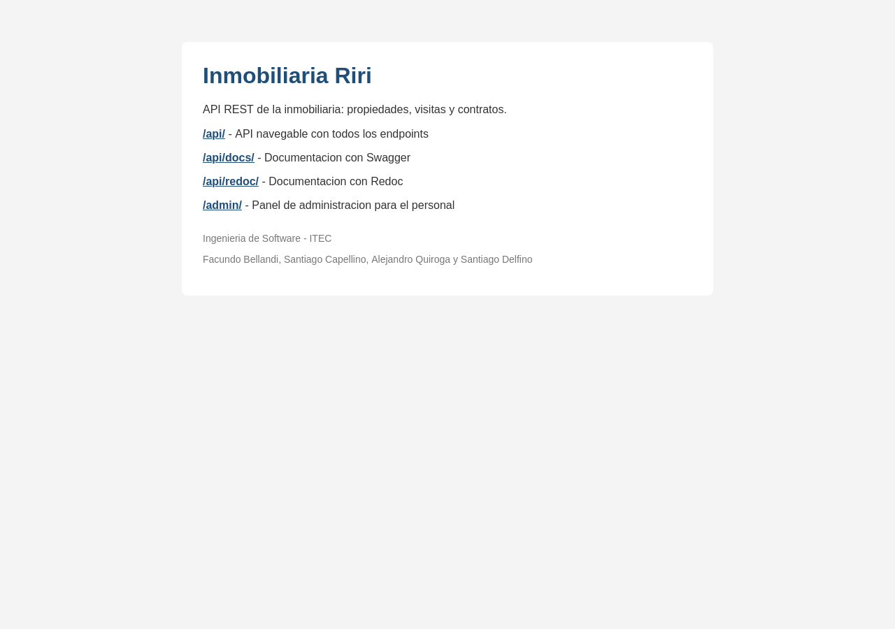
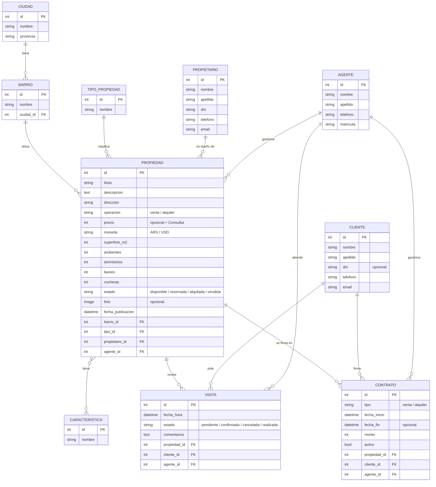
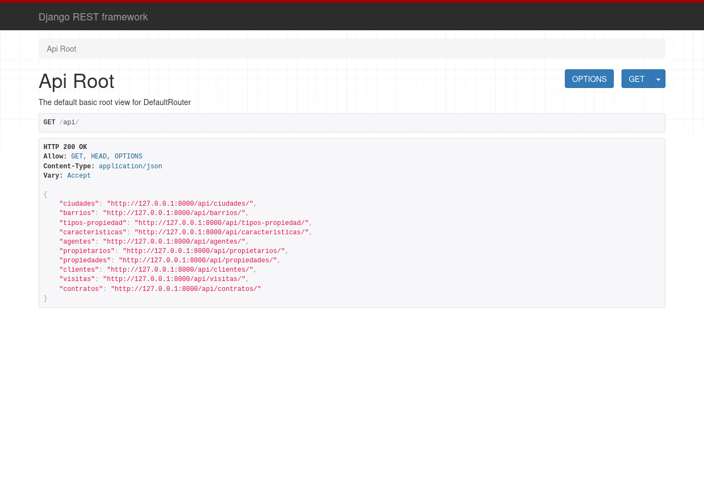
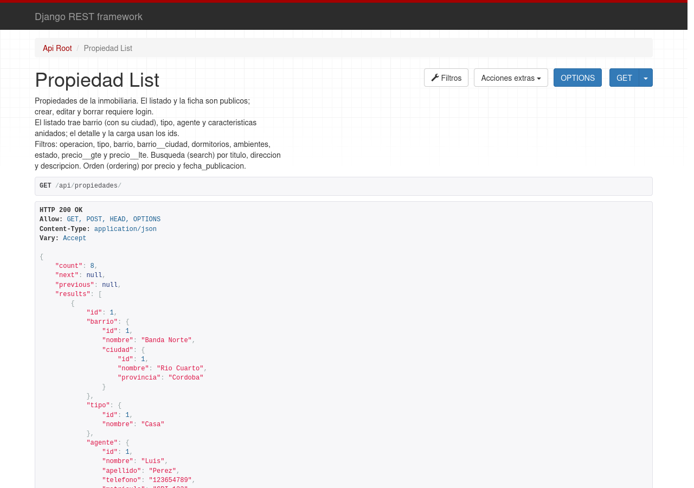
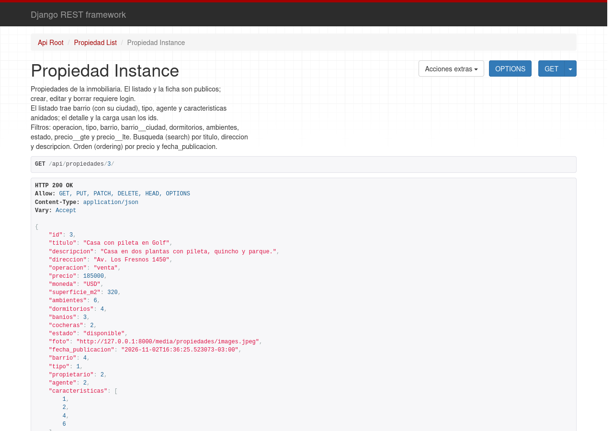
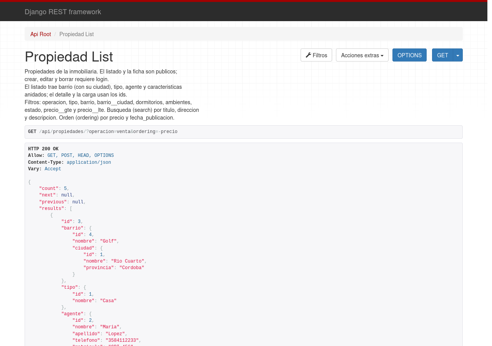
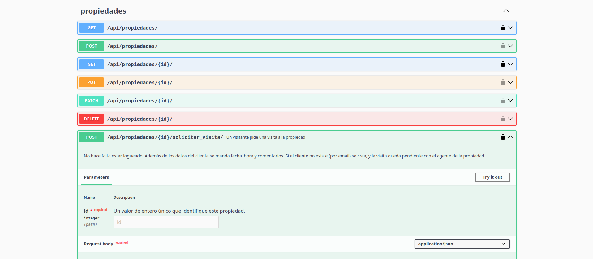
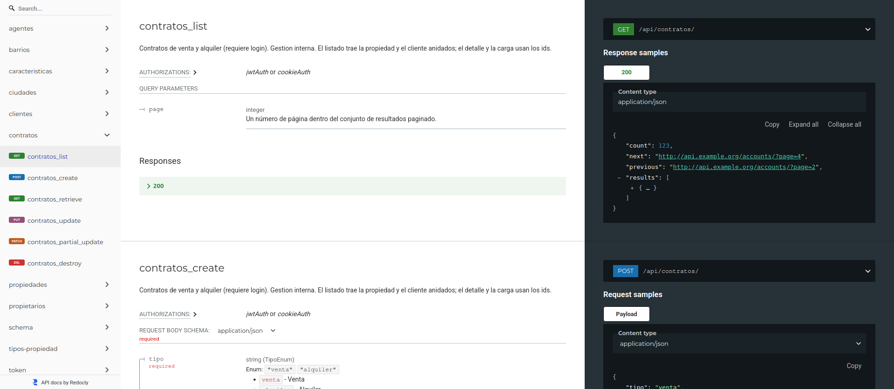
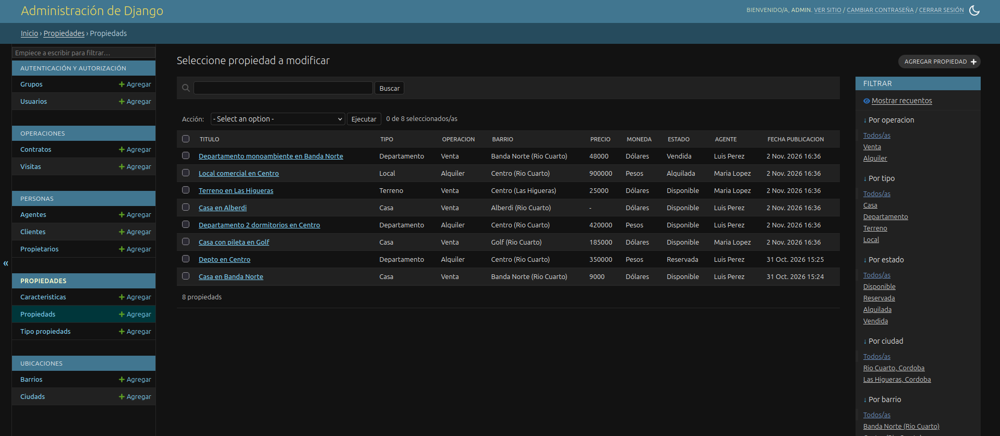

# 🏠 Inmobiliaria Riri — API REST

Back de la Evaluación Final Integradora de **Ingeniería de Software** (ITEC - Desarrollo de Software, 2026).

**Inmobiliaria Riri** es una inmobiliaria de Río Cuarto que se dedica a la venta y alquiler de casas, departamentos, locales y terrenos. Esta API REST, hecha con **Django REST Framework**, expone las propiedades con sus filtros de búsqueda, los agentes de contacto y la gestión interna de clientes, visitas y contratos. Después la consume el front que hacemos en Programación III.

Para los filtros y los datos de cada propiedad nos basamos en el buscador y la ficha de una inmobiliaria real de la ciudad ([Verdolini](https://verdolini.com.ar/index)): operación, tipo, localidad, barrio, dormitorios, precio "Consultar", contacto con el agente y el botón "Quiero visitar".



## 🛠️ Tecnologías

- Python 3.12
- Django 6.1
- Django REST Framework 3.18
- djangorestframework-simplejwt (autenticación con JWT)
- django-filter (filtros en la API)
- drf-spectacular (documentación OpenAPI, Swagger y Redoc)
- django-cors-headers (CORS para el front)
- python-dotenv (variables de entorno en un `.env`)
- Pillow (fotos de las propiedades)
- SQLite
- [uv](https://docs.astral.sh/uv/) como gestor de entornos y dependencias
- Docker y Docker Compose

## 🗂️ Planificación de la base de datos

Antes de arrancar con los modelos armamos el diagrama de tablas y relaciones. Son 10 modelos repartidos en 4 apps.



| App | Modelo | Relaciones |
|---|---|---|
| `ubicaciones` | Ciudad | — |
| `ubicaciones` | Barrio | FK → Ciudad |
| `propiedades` | TipoPropiedad | — |
| `propiedades` | Caracteristica | M2M con Propiedad |
| `propiedades` | Propiedad | FK → Barrio, TipoPropiedad, Propietario, Agente · M2M → Caracteristica |
| `personas` | Propietario | — |
| `personas` | Agente | — |
| `personas` | Cliente | — |
| `operaciones` | Visita | FK → Propiedad, Cliente, Agente |
| `operaciones` | Contrato | FK → Propiedad, Cliente, Agente |

Algunas decisiones:
- **Caracteristica** es una tabla aparte (pileta, parrilla, patio...) y no campos booleanos en Propiedad, así se pueden agregar nuevas desde el admin sin tocar el código.
- **Cliente** se identifica por email: cuando alguien pide una visita desde la web y ya existe, se reutiliza.
- Si una propiedad no tiene **precio**, en el front se muestra "Consultar".
- Si se borra un **Agente**, sus propiedades, visitas y contratos no se borran: el campo queda vacío (`SET_NULL`).

## 📁 Estructura del proyecto

```
inmobiliaria-riri-back/
├── src/
│   ├── manage.py
│   ├── settings/           # Configuración del proyecto
│   │   ├── settings.py     # Apps, DRF, JWT, paginación, spectacular, CORS
│   │   ├── urls.py         # Bienvenida, admin, token, documentación y /api/
│   │   ├── routers.py      # DefaultRouter con los 10 viewsets
│   │   └── views.py        # Vista de bienvenida
│   ├── ubicaciones/        # Ciudad y Barrio
│   ├── personas/           # Propietario, Agente y Cliente
│   ├── propiedades/        # TipoPropiedad, Caracteristica y Propiedad
│   ├── operaciones/        # Visita y Contrato
│   ├── templates/
│   │   └── inicio.html     # Template de la página de bienvenida
│   └── media/              # Fotos de las propiedades (no se sube al repo)
├── Dockerfile
├── docker-compose.yml
├── .dockerignore
├── .env.example            # Variables de entorno de ejemplo
├── pyproject.toml
└── uv.lock
```

Cada app tiene su `models.py`, `serializers.py`, `views.py` (los viewsets), `admin.py` y `tests.py`.

## 🚀 Instalación y uso

1. Clonar el repositorio:
   ```bash
   git clone https://github.com/FacBel/inmobiliaria-riri-back.git
   cd inmobiliaria-riri-back
   ```

2. Instalar las dependencias con uv:
   ```bash
   uv sync
   ```

3. Crear el `.env` a partir del ejemplo:
   ```bash
   cp .env.example .env
   ```
   Adentro van `SECRET_KEY`, `DEBUG` y `CORS_ORIGINS`. Sin el `.env`, `DEBUG` queda en `False` y el servidor no muestra los estilos del admin ni las fotos.

   > Si la `SECRET_KEY` tiene algún `$`, ponerla entre comillas simples (`SECRET_KEY='...'`). Si no, Docker Compose la toma como una variable y la corta.

4. Aplicar las migraciones y crear un usuario para el admin:
   ```bash
   cd src
   uv run manage.py migrate
   uv run manage.py createsuperuser
   ```

5. Levantar el servidor:
   ```bash
   uv run manage.py runserver
   ```

6. El proyecto queda disponible en `http://127.0.0.1:8000/`

## 🐳 Con Docker

También se puede levantar con Docker, sin instalar Python ni uv. Desde la raíz del repo (donde está el `docker-compose.yml`), con el `.env` ya creado:

```bash
docker compose up --build
```

El contenedor aplica las migraciones al arrancar y deja el proyecto en `http://localhost:8000/`. Para crear el usuario del admin adentro del contenedor:

```bash
docker compose exec web uv run manage.py createsuperuser
```

Para apagarlo:

```bash
docker compose down
```

La carpeta `src/` está montada como volumen, así que la base de datos y las fotos quedan en la compu y no se pierden al apagar el contenedor. Si se cambia el código, el servidor se reinicia solo.

## 🔌 API

Todo está bajo `/api/`, registrado en un `DefaultRouter`. Son 10 endpoints, uno por modelo:

| Endpoint | Viewset | Permisos | Para qué |
|---|---|---|---|
| `/api/ciudades/` | ReadOnlyModelViewSet | Público | Filtro "Localidad" del buscador |
| `/api/barrios/` | ReadOnlyModelViewSet | Público | Filtro "Barrio" |
| `/api/tipos-propiedad/` | ReadOnlyModelViewSet | Público | Filtro "Tipo" |
| `/api/caracteristicas/` | ReadOnlyModelViewSet | Público | Características de la ficha |
| `/api/agentes/` | ReadOnlyModelViewSet | Público | "Contactar operador" |
| `/api/propietarios/` | ReadOnlyModelViewSet | Con login | Desplegable al cargar una propiedad |
| `/api/propiedades/` | ModelViewSet | Lectura pública, escritura con login | Listado y ficha de propiedades |
| `/api/clientes/` | ModelViewSet | Con login | Gestión interna |
| `/api/visitas/` | ModelViewSet | Con login | Gestión interna |
| `/api/contratos/` | ModelViewSet | Con login | Gestión interna |

Además se puede usar la **API navegable** de DRF entrando a cualquier endpoint desde el navegador.



### Datos anidados solo en el listado

En **propiedades** y **contratos** el listado (`GET` a la lista) trae los datos relacionados anidados: la propiedad viene con su barrio (y la ciudad), el tipo, el agente y las características; el contrato, con la propiedad y el cliente. En el detalle, la creación y la edición se usan los ids (`"barrio": 4`). Para eso cada viewset elige el serializer según `self.action`.

| Listado (anidado) | Detalle (con ids) |
|---|---|
|  |  |

### Paginación

Todos los listados vienen paginados de a 10:

```json
{
    "count": 8,
    "next": null,
    "previous": null,
    "results": [ ... ]
}
```

> **Para el front:** los datos están en `results`. Esto también pasa en los desplegables (ciudades, barrios, tipos, agentes): si hay más de 10, hay que seguir el link de `next`.

### Filtros, búsqueda y orden

`/api/propiedades/` tiene los mismos filtros que el buscador de una inmobiliaria:

| Qué | Ejemplo |
|---|---|
| Operación | `?operacion=venta` / `?operacion=alquiler` |
| Tipo | `?tipo=1` |
| Localidad | `?barrio__ciudad=1` |
| Barrio | `?barrio=2` |
| Dormitorios / ambientes | `?dormitorios=3`, `?ambientes=4` |
| Estado | `?estado=disponible` |
| Rango de precio | `?precio__gte=20000&precio__lte=100000` |
| Búsqueda (título, dirección, descripción) | `?search=pileta` |
| Orden | `?ordering=precio`, `?ordering=-precio`, `?ordering=-fecha_publicacion` |

Se pueden combinar, por ejemplo `?operacion=venta&ordering=-precio` (las propiedades en venta, de la más cara a la más barata):



### Acciones personalizadas (`@action`)

| Endpoint | Método | Permisos | Qué hace |
|---|---|---|---|
| `/api/propiedades/disponibles/` | GET | Público | Lista solo las propiedades con estado disponible, paginadas |
| `/api/propiedades/{id}/solicitar_visita/` | POST | Público | El "Quiero visitar": un visitante sin cuenta pide una visita |
| `/api/visitas/{id}/confirmar/` | POST | Con login | El personal confirma una visita pendiente |

Para pedir una visita se manda:

```json
{
    "nombre": "Laura",
    "apellido": "Fernandez",
    "email": "laura@gmail.com",
    "telefono": "3584778899",
    "fecha_hora": "2026-11-10T17:00:00-03:00",
    "comentarios": "Prefiero a la tarde"
}
```

Si ya hay un cliente con ese email se reutiliza; si no, se crea. La visita queda **pendiente** y asignada al agente de la propiedad. Si la propiedad no está disponible o faltan datos, responde 400.

El flujo completo es: el visitante pide la visita → queda pendiente → el agente, logueado, la confirma con `/api/visitas/{id}/confirmar/` (si no estaba pendiente, responde 400).

## 🔐 Autenticación

Los endpoints aceptan dos tipos de autenticación:

- **JWT** (para el front): se pide el token con el usuario y la contraseña.
  ```http
  POST /api/token/
  {"username": "admin", "password": "..."}
  ```
  Devuelve un `access` (dura 2 horas) y un `refresh` (dura 10 días). El `access` se manda en cada pedido con el header:
  ```
  Authorization: Bearer <access>
  ```
  Cuando vence, se pide uno nuevo con `POST /api/token/refresh/` mandando `{"refresh": "..."}`.
- **Sesión**: para el admin y la API navegable. Si se inicia sesión en `/admin/`, también se puede usar la API desde el navegador.

Sin autenticación, los endpoints privados responden **401**.

## 📖 Documentación de la API

La documentación se genera sola con drf-spectacular a partir de los viewsets:

| Ruta | Qué es |
|---|---|
| `/api/schema/` | Esquema OpenAPI en formato YAML |
| `/api/docs/` | Swagger: se pueden probar los endpoints desde ahí |
| `/api/redoc/` | Redoc: la misma documentación en formato de lectura |





## 🧑‍💼 Panel de administración

En `/admin/` están los 10 modelos para tener control total de los datos. **Propiedades**, **Clientes**, **Visitas** y **Contratos** tienen columnas, filtros a la derecha y búsqueda. Las columnas se pueden ordenar haciendo click en el título.



## 🌐 CORS

Para que el front pueda consumir la API, los orígenes permitidos se configuran en el `.env`, separados por comas:

```
CORS_ORIGINS=http://localhost:5173
```

Por defecto está el puerto de React con Vite (`5173`). Si el front corre en otro puerto (por ejemplo `3000`), se agrega: `CORS_ORIGINS=http://localhost:5173,http://localhost:3000`.

## 🧪 Tests

Hay tests de la API de propiedades: el listado sin login (200 y paginado), crear sin login (401), crear logueado (201) y pedir una visita sin login (201, queda pendiente).

```bash
cd src
uv run manage.py test propiedades
```

## 🌿 Organización con Git

Trabajamos con una rama por etapa, creada desde `main` actualizado. Cada una se integró con un pull request revisado por el otro integrante del back.

| Etapa | Rama | Contenido | PR |
|---|---|---|---|
| 0 | `main` | Proyecto base con uv, README y diagrama de la base | — |
| 1 | `feature/modelos` | 4 apps, 10 modelos, migraciones, fotos con Pillow | #1 |
| 2 | `feature/admin` | Admin con filtros y búsqueda | #2 |
| 3 | `feature/api-base` | Serializers, viewsets y router | #3 |
| 4 | `feature/auth-permisos` | JWT + sesión y permisos por viewset | #4 |
| 5 | `feature/api-extras` | Paginación, filtros, búsqueda, `@action` y tests | #5 |
| 6 | `feature/docs-cors` | drf-spectacular, CORS y settings con `.env` | #6 |
| 7 | `feature/bienvenida` | Página de bienvenida | #7 |
| 8 | `feature/docker` | Dockerfile y docker-compose | #8 |
| 9 | `docs/readme` | README final con capturas | #9 |

## 👥 Integrantes

- Facundo Bellandi
- Santiago Capellino
- Alejandro Quiroga
- Santiago Delfino

## 📌 Estado del proyecto

Terminado y entregado para la EFI. La API ya está lista para que la consuma el front de Programación III.
